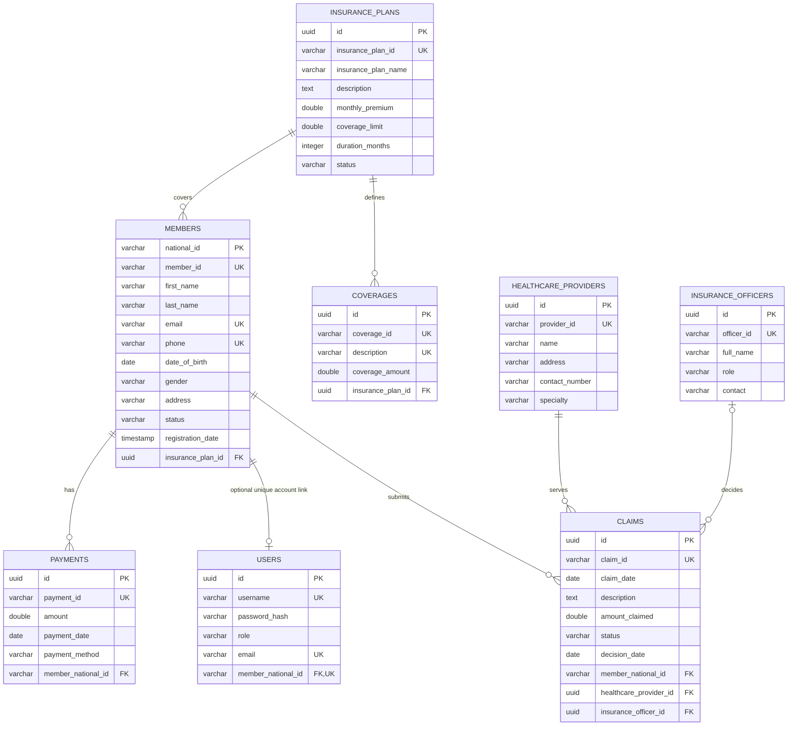

# ISIBO Domain and PostgreSQL Data Model

This model reflects the JPA entities currently in the repository. It is not a substitute for inspecting a deployed PostgreSQL schema created by earlier application versions.

## Conceptual model

An Administrator manages the system and assigns account roles. An Insurance Officer performs permitted operational work. A Customer account may be associated with one Member record. A member selects an insurance plan; plans define multiple coverage records. A member may have claims and payments. Each claim concerns one healthcare provider and may have one officer recorded as its decision-maker.

The ownership link is `users.member_national_id` → `members.national_id`. The account's generated UUID is not the member identifier and must not be substituted for it. A member may have no user account (for example, staff-created records); the optional one-to-one account link is unique.

## ER diagram

## Entity relationships and deletion considerations

| Relationship | JPA mapping / database key | Cardinality and rule |
|---|---|---|
| Insurance plan → member | `members.insurance_plan_id` | Each member has one required plan; a plan may have many members. |
| Insurance plan → coverage | `coverages.insurance_plan_id` | Each coverage belongs to one required plan; a plan may have many coverages. |
| User → member | Unique optional `users.member_national_id` | A user links to zero or one member; a member links to at most one user. |
| Member → claim | `claims.member_national_id` | Each claim belongs to one required member; a member may have many claims. |
| Member → payment | `payments.member_national_id` | Each payment belongs to one required member; a member may have many payments. |
| Provider → claim | `claims.healthcare_provider_id` | Each claim references one required provider; a provider may have many claims. |
| Officer → claim | Optional `claims.insurance_officer_id` | A claim may have no decision officer before review; one officer may decide many claims. |

No custom `@Index` declarations are present in the inspected entities. Primary keys and unique columns are indexed by PostgreSQL; foreign-key indexes should be considered only after query-plan/volume review. Explicit `ON DELETE` or `ON UPDATE` policies are not specified in the entity mappings. `InsurancePlan` declares `CascadeType.ALL` to members and coverages without orphan removal; deletion behavior should be verified against the real schema and related claim/payment references before destructive operations are enabled.

## Schema notes

- IDs are UUIDs except the member primary key (`national_id`), which is a string.
- Human-readable business identifiers are generated server-side from database sequences using three-letter prefixes (`MEM`, `PLN`, `COV`, `CLM`, `PAY`, `HCP`, and `OFF`) and zero-padded numeric suffixes. Member National IDs remain strings to preserve leading zeroes and must contain exactly 16 digits.
- JPA marks required and unique values using `@Column` and `@JoinColumn`; SQL types and default string lengths are provider/schema-generation dependent.
- Member registration time is inherited from `BaseEntity.registration_date` and is assigned with Hibernate `@CreationTimestamp`.
- Monetary fields are Java `double`; converting them to a decimal type requires a planned migration and rounding/business-rule review.
- Roles are stored in the `users.role` string column. On startup, the application normalizes recognized legacy role labels to the three canonical values; unknown role values are left unchanged and will fail role resolution at authentication.
- Production uses Hibernate `ddl-auto=update`; there is no versioned migration tool in the current Maven dependencies. A migration strategy is required before production schema changes.
